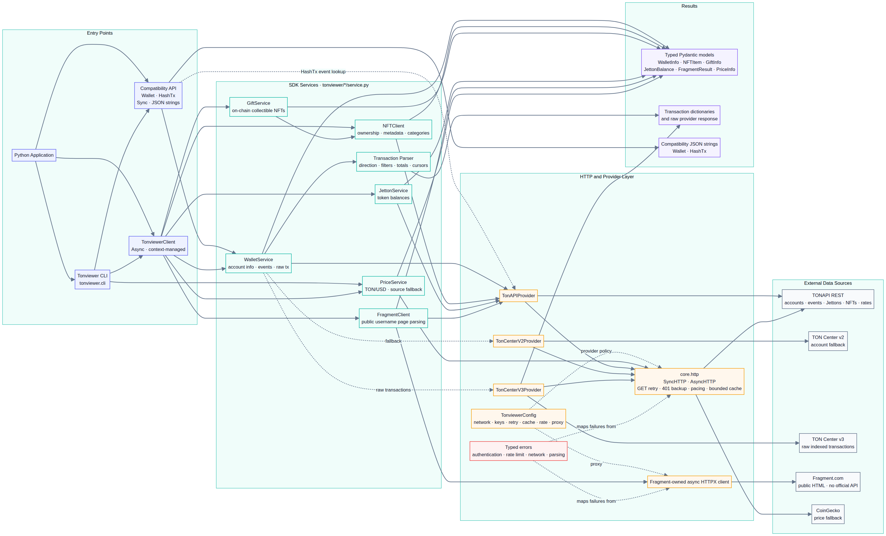

<div align="center">
  

  <p><strong>TON blockchain SDK and CLI for Python</strong></p>

  <p>
    <a href="https://pypi.org/project/Tonviewer/">📦 PyPI</a> ·
    <a href="https://github.com/DevZ44d/Tonviewer/issues">🐛 Report a bug</a> ·
    <a href="https://t.me/PyCodz_Chat">💬 Community</a> ·
    <a href="https://t.me/PyCodz">📣 Channel</a>
  </p>

  [](https://pypi.org/project/Tonviewer/)
  [](https://pypi.org/project/Tonviewer/)
  [](LICENSE)
  [](https://pypi.org/project/Tonviewer/)

  [](https://pypi.org/project/Tonviewer/)
  [](https://github.com/DevZ44d/Tonviewer/pulls)
  [](https://github.com/DevZ44d/Tonviewer/issues)
  [](https://t.me/PyCodz_Chat)
</div>

Tonviewer provides wallet information, parsed TONAPI events, raw TON Center v3 transactions, Jetton balances, NFT metadata, on-chain collectible gifts, Fragment username lookups, TON prices, and a command-line interface.

The SDK has two styles: the synchronous compatibility API (`Wallet`, `HashTx`) returns formatted JSON strings, while `TonviewerClient` exposes asynchronous services and typed Pydantic models. Feature-specific notes, output shapes, and copyable usage examples live in [`docs/README.md`](docs/README.md).

## Install

```bash
python -m pip install --upgrade Tonviewer
```

Python 3.9 or newer is required. For a source checkout and contributor setup, see [Installation](docs/installation.md).

## Quick start

### Async client

```python
import asyncio
from tonviewer import TonviewerClient

async def main():
    async with TonviewerClient() as client:
        x = await client.fragment.get_username("yyeeye")
        wallet = await client.wallet.get_info(x.owner_wallet)
        print(wallet.balance.ton, wallet.status.value, wallet.nfts_count)

        txs = await client.wallet.get_transactions(x.owner_wallet, limit=5)
        print(txs["transactions"])

asyncio.run(main())
```

### Synchronous compatibility API

```python
from tonviewer import Wallet, HashTx

wallet = Wallet("UQ...")
print(wallet.info())                         # JSON string
print(wallet.transactions(limit=5))          # JSON string
print(wallet.action("sent ton", limit=5))

print(HashTx("EVENT_OR_TRANSACTION_HASH").get())
```

The async service methods for NFTs, gifts, Jettons, and Fragment are documented separately. Those services do not all have synchronous counterparts; see [Sync and async APIs](docs/sync-async.md).

## Feature map

| Area | What it returns | Guide |
|---|---|---|
| Wallets | Typed account information, balance, status, optional name and NFT count | [Wallets](docs/wallets.md) |
| Transactions | Parsed action rows and TON totals; raw TON Center v3 response is separate | [Transactions](docs/transactions.md) |
| NFTs | Owned items, metadata, attributes, and username/gift/other categories | [NFTs](docs/nfts.md) |
| Gifts | On-chain collectible gifts represented as NFTs | [Gifts](docs/gifts.md) |
| Jettons | Token balance records with raw and human-readable amounts | [Jettons](docs/jettons.md) |
| Fragment | Public username status, sale details, and available owner information | [Fragment](docs/fragment.md) |
| Prices | TON/USD rate with source attribution | [Prices](docs/prices.md) |
| CLI | Wallet, transaction, hash, price, and Fragment commands | [CLI](docs/cli.md) |

Configuration, examples, errors, architecture, and the verified fix history are indexed in the [documentation home](docs/README.md).

## Architecture



The diagram's editable Mermaid source is [`docs/architecture.mmd`](docs/architecture.mmd). See the [architecture guide](docs/architecture.md) for provider and data-source notes.

## Configure keys

API keys are optional for public endpoints, subject to the providers' limits. Use environment variables for local development rather than committing secrets:

```powershell
$env:TONCENTER_API_KEY = "your-toncenter-key"
$env:TONCENTER_API_KEY_BACKUP = "your-optional-backup-key"
$env:TONAPI_KEY = "your-optional-tonapi-key"
```

On Linux/macOS, use `export NAME="value"`. Network, timeout, retry, rate, cache, and proxy settings are described in [Configuration](docs/configuration.md).

## Project documents

- [Documentation home and navigation](docs/README.md)
- [Installation and development setup](docs/installation.md)
- [Quick start and end-to-end examples](docs/examples.md)
- [Sync vs async API availability](docs/sync-async.md)
- [Typed output models](docs/api-reference.md)
- [Errors and troubleshooting](docs/errors.md)
- [Fixes and behavior notes](docs/changelog.md)

## Scope notes

Fragment is read from its public web pages, not an official Fragment API; parsing can be affected by page changes or access restrictions. Gift discovery covers on-chain NFTs classified as collectibles, not ordinary off-chain Telegram gifts. Username NFT categories and gift classification are metadata heuristics. Review returned data before making financial or security decisions.

## License and community

MIT License. See [LICENSE](LICENSE). Questions and bug reports: [GitHub Issues](https://github.com/DevZ44d/Tonviewer/issues). Community: [Telegram](https://t.me/PyCodz_Chat).
