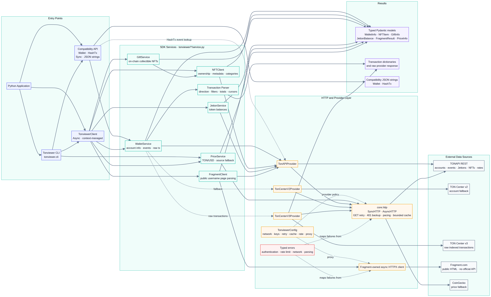

# Architecture and data sources

Editable source: [architecture.mmd](architecture.mmd).

`TonviewerClient` assembles provider clients and domain services. The public service objects are `wallet`, `nfts`, `gifts`, `jettons`, `fragment`, and `prices`. The synchronous `Wallet` and `HashTx` classes in `compat.py` preserve the legacy string-oriented interface.

## Providers

TONAPI supplies account metadata, parsed account events, Jetton balances, NFT metadata, and event lookup. Wallet information can fall back to TON Center v2. Raw indexed transaction history uses TON Center v3. TON prices use TONAPI with CoinGecko fallback. Fragment usernames are read from Fragment's public HTML pages; no official Fragment API is called by this code.

## Data handling

The shared HTTP layer configures timeout, proxy, request pacing, retries, key handling, error mapping, and a bounded cache. GET requests may be retried according to configuration; POST requests are not automatically repeated. Cache behavior is intentionally limited to rate data and individual NFT metadata. It does not cache wallet balances, account events, or owned NFT pages.

Parsed transaction output is a display-oriented transformation of indexed events. It includes wallet-relative transfer direction, participant labels, status, comments, hashes, scam flags, and optional NFT names. Raw v3 data remains available separately; do not assume the event view is a complete block-level audit record.

## Important boundaries

Live provider data can be missing or delayed. NFT gift and username categories use metadata heuristics. The scam marker is a caution flag, not a security conclusion. Fragment HTML parsing can break when its public page changes. Streaming is not implemented; enabling `use_streaming` raises a configuration error. Use a separately supported webhook solution when an application needs event delivery.
